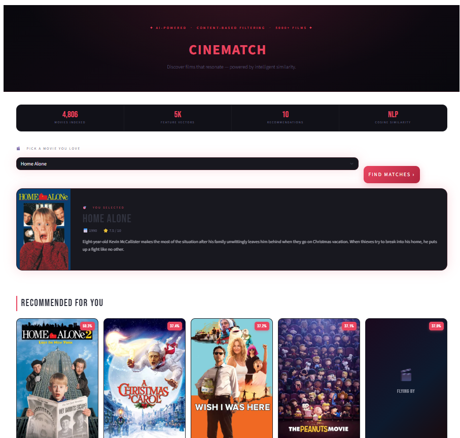

# CineMatch – Movie Recommendation System Using Machine Learning

CineMatch is a **content-based movie recommendation system** built using Python, Machine Learning, Natural Language Processing (NLP), and Streamlit. It recommends movies based on similarities in their genres, keywords, overview, cast, and director.

The project uses the TMDB 5000 Movie Dataset to process movie information, generate feature vectors, and calculate movie-to-movie similarity using Cosine Similarity. An interactive Streamlit application allows users to select a movie and explore the top 10 recommended movies, along with their posters and additional information retrieved through the TMDB API.

## Application Preview



## Features

- **Content-Based Recommendations:** Recommends movies based on similarities in movie metadata.
- **Natural Language Processing:** Processes movie descriptions and metadata using text preprocessing and stemming.
- **Count Vectorization:** Converts textual movie features into numerical vectors.
- **Cosine Similarity:** Measures similarity between movies to generate recommendations.
- **Interactive Streamlit Interface:** Provides a user-friendly interface for selecting movies and viewing recommendations.
- **TMDB API Integration:** Fetches movie posters, ratings, release years, and overviews.
- **Top 10 Recommendations:** Displays the most similar movies for a selected movie.

## Technologies Used

| Technology | Purpose |
|---|---|
| Python | Core programming language |
| Pandas | Dataset loading, merging, and manipulation |
| NumPy | Numerical operations |
| NLTK | Text preprocessing and stemming |
| Scikit-learn | CountVectorizer and Cosine Similarity |
| Pickle | Saving and loading processed data |
| Streamlit | Interactive web application |
| Requests | API requests to TMDB |
| TMDB API | Retrieving movie posters and information |

## Project Structure

```text
Movie-Recommendation-System-Using-Machine-Learning/
│
├── app.py
├── train_model.ipynb
├── app_preview.png
├── requirements.txt
├── .gitignore
└── README.md
```

**Files generated locally during model training:**

```text
movie_list.pkl
similarity.pkl
```

**Dataset files required locally:**

```text
tmdb_5000_movies.csv
tmdb_5000_credits.csv
```

The dataset and generated pickle files are not included in this GitHub repository because of their file sizes. They must be downloaded or generated locally before running the application.

## Dataset

This project uses the **TMDB 5000 Movie Dataset**, which contains movie information such as titles, genres, keywords, overviews, cast members, and crew details.

Dataset source:

[TMDB 5000 Movie Dataset – Kaggle](https://www.kaggle.com/datasets/tmdb/tmdb-movie-metadata)

### How to Download the Dataset

1. Open the Kaggle dataset link above.
2. Sign in to your Kaggle account.
3. Download the dataset ZIP file.
4. Extract the downloaded ZIP file.
5. Locate these two CSV files:
   - `tmdb_5000_movies.csv`
   - `tmdb_5000_credits.csv`
6. Place both CSV files in the root directory of the project, alongside `train_model.ipynb` and `app.py`.

**Important:** Keep the filenames exactly as shown above because the training notebook uses these filenames to load the datasets.

## How the Recommendation System Works

CineMatch uses content-based filtering to identify movies with similar characteristics.

### Model Training Workflow

**1. Dataset Loading and Merging**

- Loads the movies and credits CSV files using Pandas.
- Merges both datasets using the movie title.
- Selects the required columns: movie ID, title, overview, genres, keywords, cast, and crew.

**2. Data Preprocessing**

- Removes rows containing missing values.
- Converts genres and keywords from string representations into Python lists using `ast.literal_eval()`.
- Extracts the top three cast members.
- Extracts the director's name from the crew information.
- Splits movie overviews into individual words.
- Removes spaces from names and metadata terms to maintain consistent text features.

**3. Feature Combination**

Combines the following movie attributes into a single `tags` column:

- Movie overview
- Genres
- Keywords
- Top three cast members
- Director

These combined tags represent the important characteristics of each movie.

**4. Text Processing and Stemming**

- Converts the combined tags into lowercase text.
- Uses NLTK's Porter Stemmer to reduce words to their root forms.
- Helps treat related word variations as similar features.

**5. Count Vectorization**

Uses Scikit-learn's `CountVectorizer` with:

- `max_features=5000`
- `stop_words='english'`

This converts the processed text into numerical feature vectors using the 5,000 most frequent features, excluding common English stop words.

**6. Cosine Similarity Calculation**

Uses `cosine_similarity()` to calculate similarity scores between movie vectors.

Movies with higher similarity scores are considered more similar based on their processed metadata.

**7. Model File Generation**

The training notebook saves two files using Pickle:

| File | Purpose |
|---|---|
| `movie_list.pkl` | Stores the processed movie DataFrame containing movie IDs, titles, and tags. |
| `similarity.pkl` | Stores the cosine similarity matrix used to identify similar movies. |

These files are loaded by the Streamlit application to generate recommendations without repeating the entire model-training process every time the application starts.

### Recommendation Workflow

When a user selects a movie:

1. The application finds the selected movie in `movie_list.pkl`.
2. It retrieves the corresponding row from the similarity matrix.
3. It ranks other movies according to their similarity scores.
4. It excludes the selected movie itself.
5. It displays the top 10 recommended movies.

### Overall Project Architecture

```text
TMDB 5000 Movies Dataset
          |
          v
    Data Preprocessing
          |
          v
     Feature Extraction
          |
          v
      Create Movie Tags
          |
          v
       Text Stemming
          |
          v
     Count Vectorization
          |
          v
    Cosine Similarity
          |
          v
    Save Pickle Files
     /             \
    v               v
movie_list.pkl  similarity.pkl
     \             /
      v           v
       Streamlit App
             |
             v
       Movie Selection
             |
             v
    Similarity-Based Ranking
             |
             v
      Top 10 Recommendations
             |
             v
       TMDB API Integration
             |
             v
   Posters and Movie Information
```

## TMDB API Integration

CineMatch integrates the **The Movie Database (TMDB) API** to retrieve movie information for the application's interface.

The recommendation engine and TMDB API have separate responsibilities:

- **Machine Learning model:** Calculates movie similarity and determines which movies to recommend.
- **TMDB API:** Retrieves posters, ratings, release years, and movie overviews for display.

### Getting a TMDB API Key

1. Visit [The Movie Database](https://www.themoviedb.org/).
2. Create an account or sign in.
3. Open your account settings.
4. Navigate to the API section.
5. Apply for an API key.
6. Copy your API Key (v3 auth).

### Configuring the API Key

Create a folder named `.streamlit` in the project root.

Inside it, create a file named `secrets.toml`:

```toml
TMDB_API_KEY = "YOUR_ACTUAL_API_KEY"
```

Replace the placeholder with your actual TMDB API key.

**Security Note:** Never upload your API key or `secrets.toml` file to GitHub. The project `.gitignore` excludes this file.

## Installation and Setup

### 1. Clone the Repository

```bash
git clone https://github.com/YOUR-USERNAME/Movie-Recommendation-System-Using-Machine-Learning.git
```

Navigate into the project directory:

```bash
cd Movie-Recommendation-System-Using-Machine-Learning
```

### 2. Create a Virtual Environment

```bash
python -m venv myenv
```

Activate it on Windows:

```bash
myenv\Scripts\activate
```

### 3. Install Dependencies

```bash
pip install -r requirements.txt
```

### 4. Download the Dataset

Download and extract the two CSV files described in the Dataset section. Place them in the project's root directory.

### 5. Generate the Model Files

Open `train_model.ipynb` using Jupyter Notebook or VS Code.

Run all notebook cells in order.

The notebook will:

- Load and preprocess the datasets.
- Extract movie features.
- Apply text stemming and Count Vectorization.
- Calculate Cosine Similarity.
- Generate `movie_list.pkl` and `similarity.pkl`.

After successful execution, verify that both pickle files are present in the project root directory.

**Note:** Model training is required before launching the application because `app.py` loads these two pickle files.

### 6. Configure TMDB API

Create `.streamlit/secrets.toml` and add your TMDB API key as explained in the API Integration section.

### 7. Run the Streamlit Application

```bash
streamlit run app.py
```

The application will open in your browser.

## Requirements

The project dependencies are listed in `requirements.txt`:

```text
streamlit
pandas
numpy
scikit-learn
nltk
requests
```

## Future Enhancements

- Improve recommendation quality through additional movie features.
- Introduce collaborative filtering.
- Add user-based personalized recommendations.
- Include movie search and filtering options.
- Explore hybrid recommendation techniques.

## Acknowledgements

- [TMDB](https://www.themoviedb.org/) for movie metadata and API services.
- [Kaggle](https://www.kaggle.com/) for hosting the TMDB 5000 Movie Dataset.
- [Scikit-learn](https://scikit-learn.org/) for machine learning and text vectorization tools.
- [NLTK](https://www.nltk.org/) for natural language processing tools.
- [Streamlit](https://streamlit.io/) for the interactive application framework.

---

**CineMatch – Discover movies that match your taste!**
